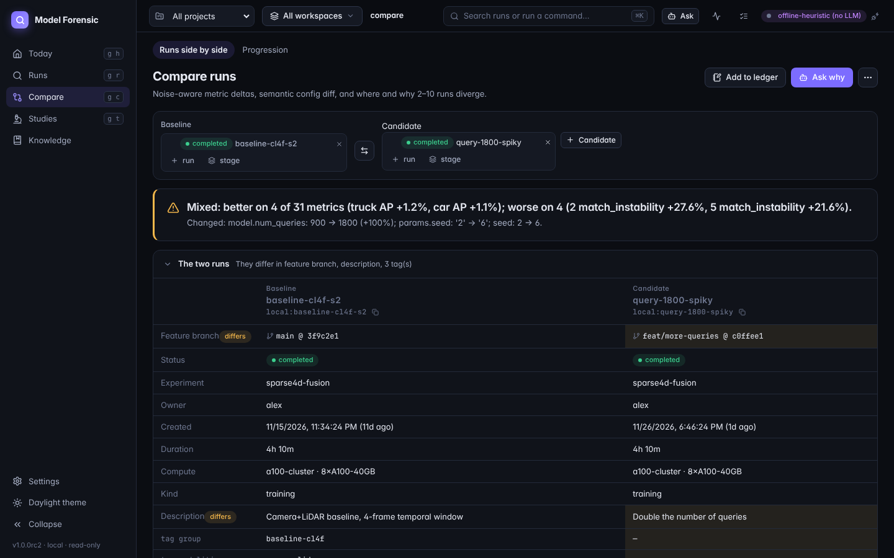
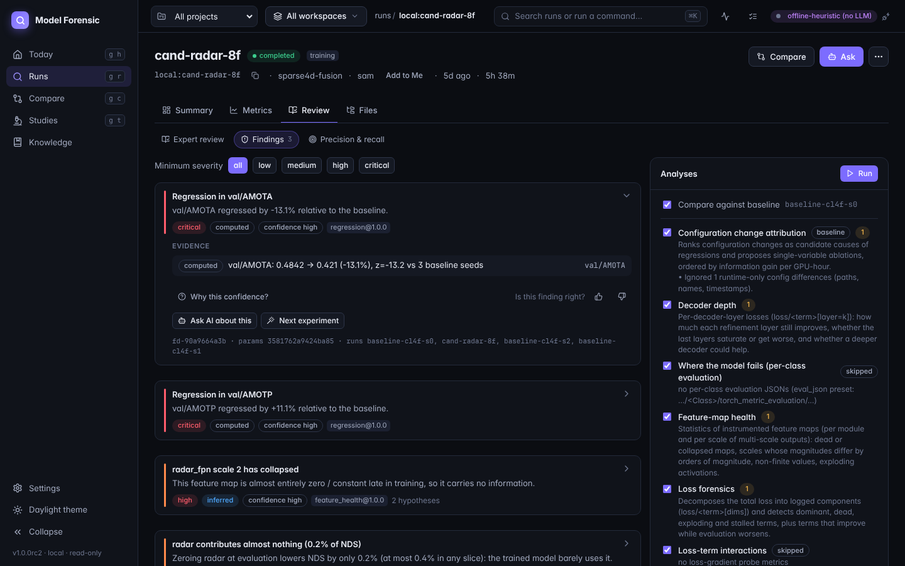
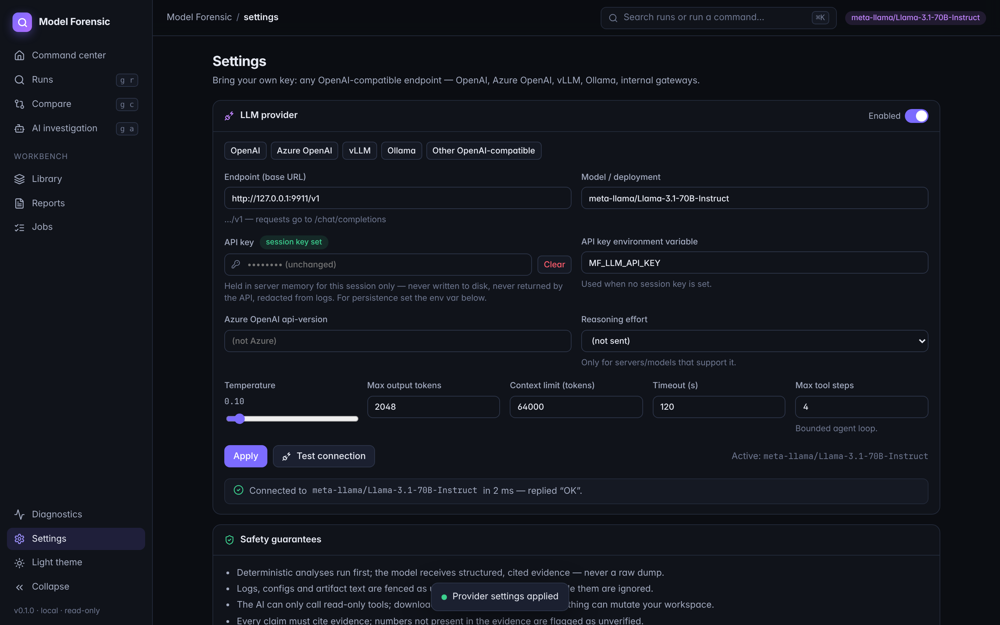
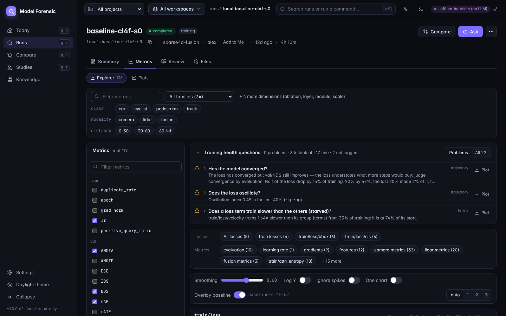

# Model Forensic

A forensic workbench for ML experiments (Azure ML first; backend-agnostic by design). It shortens
the path from **"something is wrong with this model"** to **"here is the evidence, the most likely
causes, the competing hypotheses, and the cheapest experiment that separates them."**


> **Status:** backend, HTTP API, CLI and web UI are implemented and tested (91 backend tests, strict
> typing on both sides). The Azure ML connector passes the shared connector test suite against SDK
> fakes but has **not yet been validated against a live workspace**. All screenshots below use the
> built-in synthetic demo data (`mf demo`). See [`docs/architecture.md`](docs/architecture.md) §26.

## Features

| | |
|---|---|
| **Workspaces** | Several Azure ML workspaces configured side by side; a dropdown scopes every search, list and picker to the one you work in. An unreachable workspace is shown with the reason and doesn't block the others |
| **Progression across runs** | Overlay loss and metric curves of up to 30 runs — e.g. everyone's jobs this week. X-axis by step, epoch or hours since start; colour by run, user, experiment or any config value that differs; live refresh for running jobs; per-run ranking table |
| **Find runs fast** | Local search index (≈1 ms per query), filters, metric ranges, config values, and plain-English queries whose interpretation is shown to you |
| **Inspect a run** | Auto-selected baseline, *What changed?* (semantic config diff + metrics that moved beyond seed noise), details, pipeline lineage, link to Azure ML Studio |
| **Plot** | Fast canvas charts: multi-metric, smoothing, log scale, baseline overlay, linked cursors, zoom, PNG/CSV export, per-slice breakdowns (range, class, …) |
| **Compare** | Noise-aware deltas: z-scores against baseline seed replicates when available, explicit warning when not; config diff that ignores runtime noise |
| **Debug** | Deterministic analysis packs → structured findings with evidence, hypotheses (never stated as fact), recommended experiments and provenance; config diff; log search |
| **Download** | Profiles (fast debug / evaluation / checkpoints / everything) with size estimates, resumable checksum-verified cached downloads with live progress, per-file browser download |
| **Ask AI (BYOK)** | Any OpenAI-compatible endpoint (OpenAI, Azure OpenAI, vLLM, Ollama). Every claim is labelled and checked against cited evidence; invented numbers are flagged |
| **Report** | Markdown and print-to-PDF forensic reports generated from stored findings |
| **Keyboard-first** | ⌘K / Ctrl+K command palette, `g r` · `g c` · `g a` · `g s` shortcuts, dark and light themes |

## Tour

### Search runs — filters or plain English

Queries like `failed training jobs from last week` are rewritten into the filter language, and the
rewrite is shown so you can check it.


### Choose your workspace

Configure each Azure ML workspace in `model-forensic.yaml`; the dropdown scopes search, lists and
run pickers to the selected one (or shows all, labelled by workspace).


### Study progression across many runs

Select runs (for example `user:priya since:7d` → *Add all*, or tick rows in Runs → *Plot progression*)
and overlay their curves. Colour by user to see each person's jobs, or by a config value that differs
between runs (here the learning rate). Switch the x-axis to *hours since start* to compare wall-clock
speed, or *epoch* if your jobs log one. Running jobs refresh every 15 s.


The table below the charts ranks runs by the final value of the first metric, with best value and the
step it was reached, how far each run got, and when it last logged.


### Plot metrics against the baseline

Pick any metrics; the baseline is overlaid as a dashed line. Training curves are smoothed, with the raw
series kept faint behind them.


### Compare two runs

Deltas are judged against the spread of the baseline's seed replicates (z-scores), not a fixed
threshold. Slice metrics show *where* it got worse — here, mostly at long range.



### Findings, hypotheses and the next experiment

Analyses are deterministic and reproducible. Config changes are only ever offered as **hypotheses**
(they are confounded), each with the single-variable ablation that would test it, ranked by expected
information gain per GPU-hour.



### Debug logs

Regex search with match navigation, error/warning highlighting, jump to first error, download.


### Download artifacts

Choose a profile so multi-GB checkpoints aren't pulled for a quick look. Downloads run in the
background with progress and can be cancelled.


### Bring your own model

Configure any OpenAI-compatible endpoint from the UI. The key is held in server memory for the session
only — never written to disk, never returned by the API, and redacted from logs.



### Grounded AI investigation

Deterministic analyses run first; the model only interprets their evidence and must cite it
(`E11`, …). Here a claim with an invented number ("42%") is caught and marked **unverified**.


<sub>This screenshot was taken against a local stand-in OpenAI-compatible server that deliberately
returns one wrong number, to show the check working; the model name shown is just the configured
label. Without any key, the app uses a clearly labelled offline interpreter.</sub>

### Command palette, home and light theme

| | |
|---|---|
|  |  |
|  | |

## Quick start (demo mode, no cloud needed)

```bash
uv venv && source .venv/bin/activate         # or python -m venv .venv
uv pip install -e "backend[dev]"
(cd web && npm install && npm run build)      # build the web UI once
mf demo                                       # writes 14 synthetic runs to .mf/demo-runs and indexes them
mf serve                                      # UI at http://127.0.0.1:8765 · API docs at /docs
```

Everything is also available from the command line:

```bash
mf search "failed training jobs from last week"
mf show cand-radar-8f                         # overview + what changed vs auto-selected baseline
mf compare baseline-cl4f-s0 cand-radar-8f     # noise-aware deltas, semantic config diff
mf analyze cand-radar-8f --baseline baseline-cl4f-s0
mf ask cand-radar-8f --baseline baseline-cl4f-s0 --prompt why_worse
mf report cand-radar-8f --baseline baseline-cl4f-s0 -o report.md
```

For UI development: `mf serve` in one terminal, `cd web && npm run dev` in another
(http://localhost:5173). See [`web/README.md`](web/README.md).

## Connect Azure ML and an LLM

```bash
uv pip install -e "backend[azure]"
az login                                      # or managed identity / workload identity
cp model-forensic.example.yaml model-forensic.yaml   # one `backends:` entry per Azure ML workspace
export MF_LLM_API_KEY=...                     # only the env var NAME is stored in config
mf doctor && mf sync
```

Or set the LLM endpoint and key from **Settings** in the UI.

## Documentation

- [Requirements critique](docs/requirements-critique.md) — risks found in the spec and how the design responds
- [Architecture & product design](docs/architecture.md) — personas, journeys, components, interfaces, API, security, roadmap
- [ADRs](docs/adr/) — key decisions
- [Development guide](docs/development.md) — workflow, conventions, troubleshooting
- [Web UI](web/README.md) — stack, screens, shortcuts

## Layout

```
backend/src/model_forensic/
  domain/        vendor-neutral types (Run, MetricKey/Series, Finding, Evidence, ...)
  analysis/      deterministic computation: signal, comparison, config diff, plugins
  application/   ports + ForensicService
  ai/            context builder, grounding, prompt library, tools, investigator
  infrastructure/connectors (azureml, local), search, artifacts, persistence, llm, demo
  api/ cli/ reports/ observability/ shared/
backend/tests/   unit · integration · contract · e2e (91 tests)
web/             React + TypeScript UI (Vite, TanStack Query, uPlot)
docs/            architecture, critique, ADRs, development guide, screenshots
```
