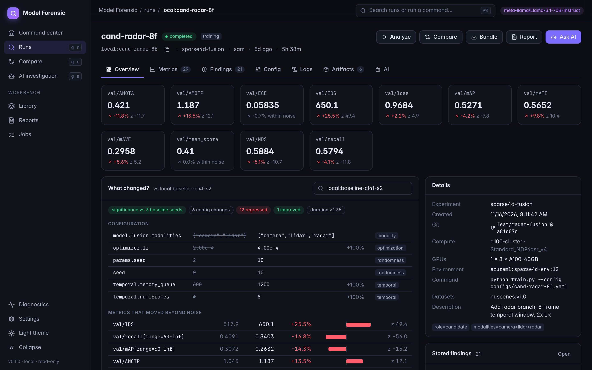
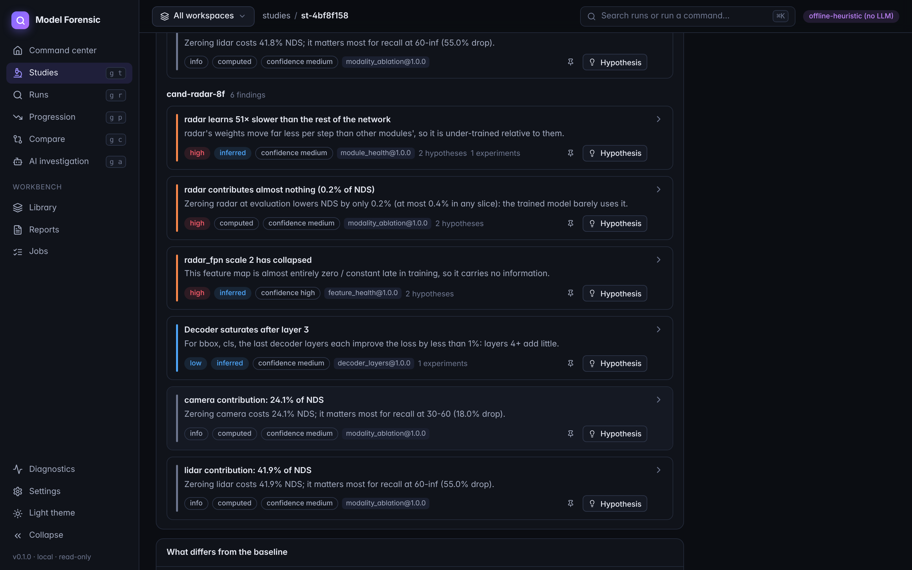
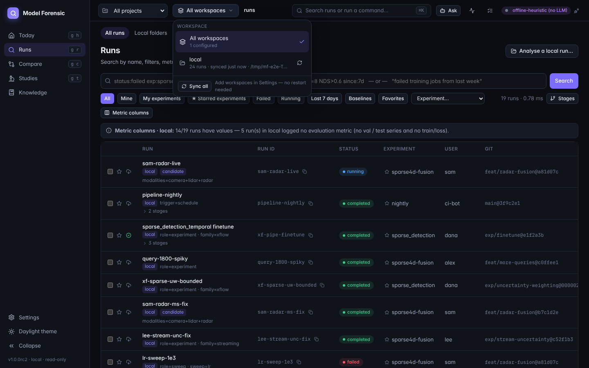
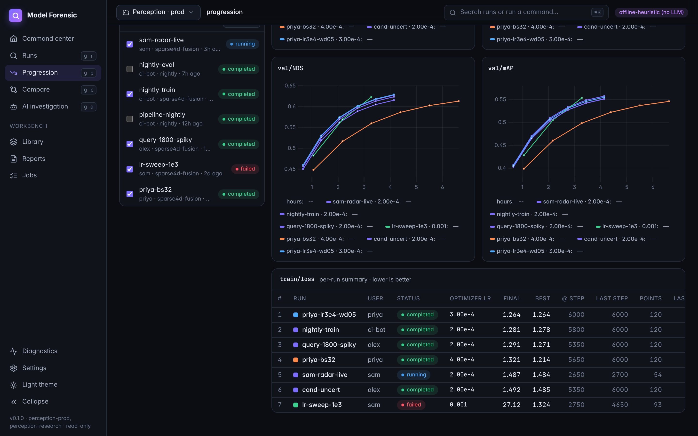
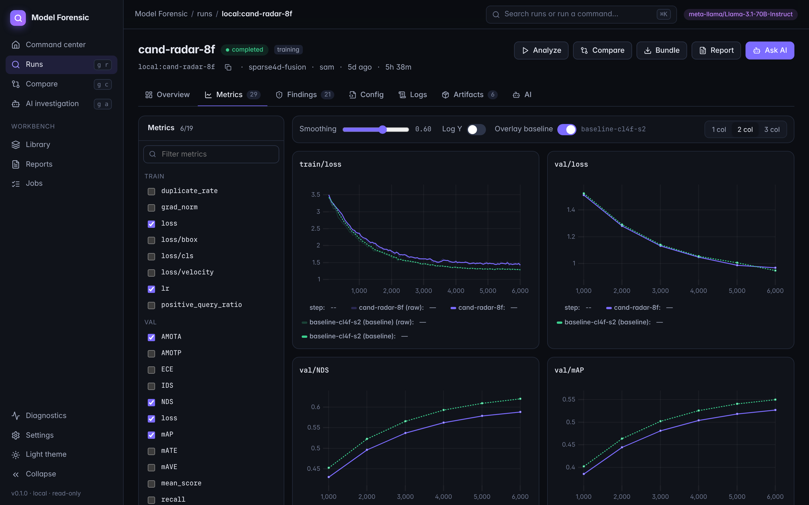
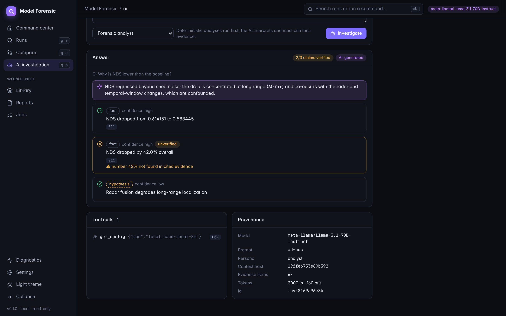
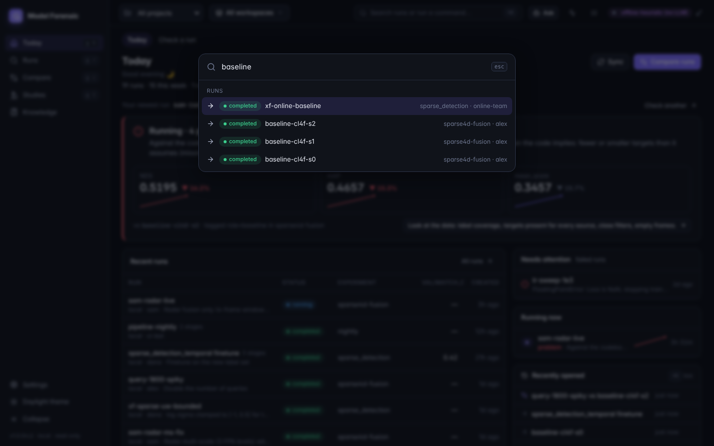

# Model Forensic

A forensic workbench for ML experiments (Azure ML first; backend-agnostic by design). It shortens
the path from **"something is wrong with this model"** to **"here is the evidence, the most likely
causes, the competing hypotheses, and the cheapest experiment that separates them."**



> **Status:** backend, HTTP API, CLI and web UI are implemented and tested (backend, kit and UI tested, strict
> typing on both sides). The Azure ML connector follows the access path of the field-tested v1 tool
> (az-login credential first, raw ARM job listing, run-history metrics, pipeline stages and stage outputs)
> and passes the connector tests with SDK fakes, but this implementation has **not yet been run against a
> live workspace**. All screenshots below use the
> built-in synthetic demo data (`mf demo`). See [`docs/architecture.md`](docs/architecture.md) §26.

## Features

| | |
|---|---|
| **Studies** | Study one experiment or a small group in depth: evidence board (metrics vs baseline, config differences, architecture diagnostics), hypotheses with status and evidence, the architecture change each suggests, the run that tests it, one-click verification, notes, timeline, Markdown export |
| **Instrumentation kit** | `model-forensic-instrument`: a few lines in your PyTorch / MMDetection3D training code log per-module learning health, feature-map statistics (per FPN scale), per-decoder-layer losses (incl. StreamPETR denoising / aux-2D branches), uncertainty-head calibration, temporal-memory benefit by sequence position, loss-term gradient conflicts and evaluation with a branch zeroed — to Azure ML via MLflow. Works with plain PyTorch, MMEngine and mmcv 1.x. See [`instrument/README.md`](instrument/README.md) |
| **Architecture diagnostics** | Analyses over those metrics: branches that barely learn, modality contributions per range, collapsed or imbalanced feature maps, decoder depth |
| **Workspaces** | Several Azure ML workspaces configured side by side; a dropdown scopes every search, list and picker to the one you work in. An unreachable workspace is shown with the reason and doesn't block the others |
| **Progression across runs** | Overlay loss and metric curves of up to 30 runs — e.g. everyone's jobs this week. X-axis by step, epoch or hours since start; colour by run, user, experiment or any config value that differs; live refresh for running jobs; per-run ranking table |
| **Find runs fast** | Local search index (≈1 ms per query), filters, metric ranges, config values, and plain-English queries whose interpretation is shown to you |
| **Inspect a run** | Auto-selected baseline, *What changed?* (semantic config diff + metrics that moved beyond seed noise), details, pipeline lineage, link to Azure ML Studio |
| **Plot** | Fast canvas charts: multi-metric, smoothing, log scale, baseline overlay, linked cursors, zoom, PNG/CSV export, per-slice breakdowns (range, class, …) |
| **Compare** | Noise-aware deltas: z-scores against baseline seed replicates when available, explicit warning when not; config diff that ignores runtime noise |
| **Debug** | Deterministic analysis packs → structured findings with evidence, hypotheses (never stated as fact), recommended experiments and provenance; config diff; log search |
| **Download** | Profiles (fast debug / evaluation / checkpoints / everything) with size estimates, resumable checksum-verified cached downloads with live progress, per-file browser download |
| **Ask AI (BYOK)** | Any OpenAI-compatible endpoint (OpenAI, Azure OpenAI, vLLM, Ollama). Every claim is labelled and checked against cited evidence; invented numbers are flagged |
| **108 prompt templates** | Ready-made questions for your (local) LLM, grouped by topic — camera backbone, radar multi-scale features, fusion, temporal, detection head, uncertainty & streaming heads, learned task weights, class × distance evaluation, training, logs, data, review. Each template pulls in the evidence it needs (log errors, loss-curve digests, the relevant config values) and can cover up to 9 runs at once. See the [catalog](docs/prompt-catalog.md) |
| **Report** | Markdown and print-to-PDF forensic reports generated from stored findings |
| **Keyboard-first** | ⌘K / Ctrl+K command palette, `g r` · `g c` · `g a` · `g s` shortcuts, dark and light themes |

## Tour

### Search runs — filters or plain English

Queries like `failed training jobs from last week` are rewritten into the filter language, and the
rewrite is shown so you can check it.


### Study an experiment and decide the next architecture change

A study collects one experiment or a small group with a baseline. The **Evidence** tab compares their
metrics (deltas coloured only beyond seed noise) and runs the architecture diagnostics. Here they show
that in `cand-radar-8f` the radar branch learns 51× slower than the rest of the network, contributes
only 0.2% NDS, and one radar FPN scale has collapsed.



Turn a finding (or an AI claim) into a **hypothesis** with the change it suggests, train that change,
link it as the hypothesis' test run and press **Verify**: the test run is compared with the run where the
problem was observed. The result says honestly when more than one thing changed. Then mark the hypothesis
supported or rejected; the journal (notes + timeline) and a Markdown export keep the reasoning.


To produce the architecture metrics, add the [instrumentation kit](instrument/README.md) to your training
code (plain PyTorch or an MMEngine hook):

```python
fx = Forensic(model, groups={"camera": "img_backbone", "radar": ["radar_encoder", "radar_neck"],
                             "fusion": "fusion_layer", "decoder": "pts_bbox_head.transformer.decoder"},
              features={"radar_fpn": "radar_neck"}, every=50)
# in the loop:  fx.start_step(i); ...backward...; fx.after_backward(i); optimizer.step(); fx.after_step(i); fx.log_losses(losses, i)
# at eval:      ablation_eval(model, run_eval, {"no_radar": "radar_neck", "no_camera": "img_backbone"}, sink=fx.sink, step=i)
```

### Choose your workspace

Configure each Azure ML workspace in `model-forensic.yaml`; the dropdown scopes search, lists and
run pickers to the selected one (or shows all, labelled by workspace).



### Study progression across many runs

Select runs (for example `user:priya since:7d` → *Add all*, or tick rows in Runs → *Plot progression*)
and overlay their curves. Colour by user to see each person's jobs, or by a config value that differs
between runs (here the learning rate). Switch the x-axis to *hours since start* to compare wall-clock
speed, or *epoch* if your jobs log one. Running jobs refresh every 15 s.


The table below the charts ranks runs by the final value of the first metric, with best value and the
step it was reached, how far each run got, and when it last logged.



### Plot metrics against the baseline

Pick any metrics; the baseline is overlaid as a dashed line. Training curves are smoothed, with the raw
series kept faint behind them.



### Compare two runs

Deltas are judged against the spread of the baseline's seed replicates (z-scores), not a fixed
threshold. Slice metrics show *where* it got worse — here, mostly at long range.


### Findings, hypotheses and the next experiment

Analyses are deterministic and reproducible. Config changes are only ever offered as **hypotheses**
(they are confounded), each with the single-variable ablation that would test it, ranked by expected
information gain per GPU-hour.


### Debug logs

Regex search with match navigation, error/warning highlighting, jump to first error, download.


### Download artifacts

Choose a profile so multi-GB checkpoints aren't pulled for a quick look. Downloads run in the
background with progress and can be cancelled.


### Bring your own model

Configure any OpenAI-compatible endpoint from the UI. The key is held in server memory for the session
only — never written to disk, never returned by the API, and redacted from logs.


### Prompt templates for your LLM

Pick from 108 templates (search *radar*, *backbone*, *NaN*, *sweep* …), fill in what changed, and see the
exact question before it is sent. Each template also lists the extra evidence it adds to the model's
context — here the radar/fusion config values, loss-curve digests and per-range metrics.


From **Progression**, *Ask AI about these runs* sends the whole selection (up to 9 runs), so multi-run
templates like *Compare everyone's runs*, *Rank several experiments* or *Analyse a sweep* see all of them.
On the command line:

```bash
mf prompts --category "Radar branch"
mf ask cand-radar-8f --baseline baseline-cl4f-s0 --prompt cmp_radar_multiscale --var change_description="radar FPN 1 → 3 levels"
mf ask baseline-cl4f-s0 --prompt cmp_multi_users --other priya-bs32 --other cand-radar-8f
```

Templates are YAML files in [`backend/src/model_forensic/ai/prompt_packs/`](backend/src/model_forensic/ai/prompt_packs/README.md);
add your own packs via `prompt_dirs:` in `model-forensic.yaml`. **Local models:** if your server or
model doesn't support tool calling, set *Max tool steps* to 0 in Settings, and set *Context limit* to
your model's window — the context is trimmed to fit (curve digests and config lines go first; run
identities and findings stay).

### Grounded AI investigation

Deterministic analyses run first; the model only interprets their evidence and must cite it
(`E11`, …). Here a claim with an invented number ("42%") is caught and marked **unverified**.



<sub>This screenshot was taken against a local stand-in OpenAI-compatible server that deliberately
returns one wrong number, to show the check working; the model name shown is just the configured
label. Without any key, the app uses a clearly labelled offline interpreter.</sub>

### Command palette, home and light theme

| | |
|---|---|
|  |  |
|  | |

## Quick start (demo mode, no cloud needed)

```bash
uv venv && source .venv/bin/activate         # or python -m venv .venv
uv pip install -e "backend[dev]"
(cd web && npm install && npm run build)      # build the web UI once
mf demo                                       # writes 15 synthetic runs to .mf/demo-runs and indexes them
mf serve                                      # UI at http://127.0.0.1:8765 · API docs at /docs
```

Everything is also available from the command line:

```bash
mf search "failed training jobs from last week"
mf show cand-radar-8f                         # overview + what changed vs auto-selected baseline
mf compare baseline-cl4f-s0 cand-radar-8f     # noise-aware deltas, semantic config diff
mf analyze cand-radar-8f --baseline baseline-cl4f-s0
mf ask cand-radar-8f --baseline baseline-cl4f-s0 --prompt why_worse
mf report cand-radar-8f --baseline baseline-cl4f-s0 -o report.md
```

For UI development: `mf serve` in one terminal, `cd web && npm run dev` in another
(http://localhost:5173). See [`web/README.md`](web/README.md).

## Connect Azure ML and an LLM

```bash
uv pip install -e "backend[azure]"
az login                                      # or managed identity / workload identity
cp model-forensic.example.yaml model-forensic.yaml   # one `backends:` entry per Azure ML workspace
export MF_LLM_API_KEY=...                     # only the env var NAME is stored in config
mf doctor && mf sync
```

Or set the LLM endpoint and key from **Settings** in the UI.

Metric names are mapped to canonical keys on the way in, so existing runs work without re-logging:
generic `train_*`/`val_*`, MLflow-safe `name__k_v`, and the xflow multi-task layout
(`train_<task>/d<k>_loss_<term>/{weighted_loss,unweighted_loss,uncertainty_weight_log_sigma}`,
`evaluation/<task>/<Class>`, `…pr_curves_detailed.auc…`, `…working_point…`) — see
[`connectors/naming.py`](backend/src/model_forensic/infrastructure/connectors/naming.py).

## Documentation

- [Requirements critique](docs/requirements-critique.md) — risks found in the spec and how the design responds
- [Architecture & product design](docs/architecture.md) — personas, journeys, components, interfaces, API, security, roadmap
- [ADRs](docs/adr/) — key decisions
- [Development guide](docs/development.md) — workflow, conventions, troubleshooting
- [Web UI](web/README.md) — stack, screens, shortcuts
- [Prompt template catalog](docs/prompt-catalog.md) — all built-in templates, their variables and evidence

## Layout

```
backend/src/model_forensic/
  domain/        vendor-neutral types (Run, MetricKey/Series, Finding, Evidence, ...)
  analysis/      deterministic computation: signal, comparison, config diff, plugins
  application/   ports + ForensicService
  ai/            context builder, grounding, prompt library, tools, investigator
  infrastructure/connectors (azureml, local), search, artifacts, persistence, llm, demo
  api/ cli/ reports/ observability/ shared/
backend/tests/   unit · integration · contract · e2e
instrument/      model-forensic-instrument: training-side metrics kit (PyTorch, MMEngine hook) + tests
web/             React + TypeScript UI (Vite, TanStack Query, uPlot)
docs/            architecture, critique, ADRs, development guide, screenshots
```
