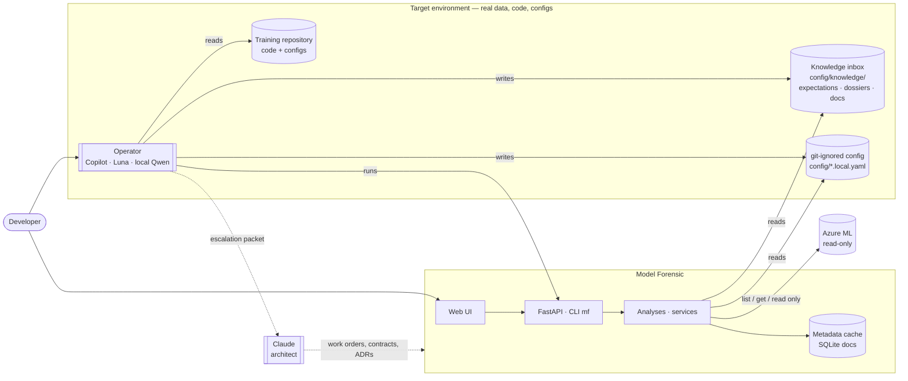
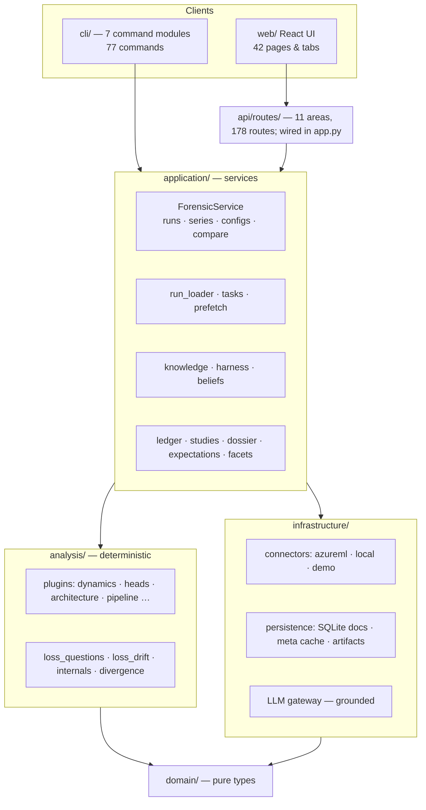
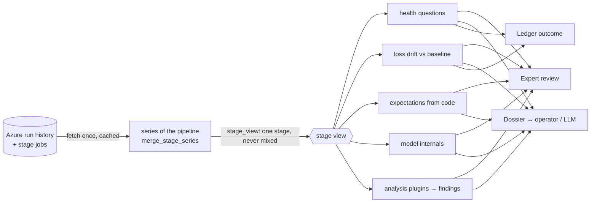
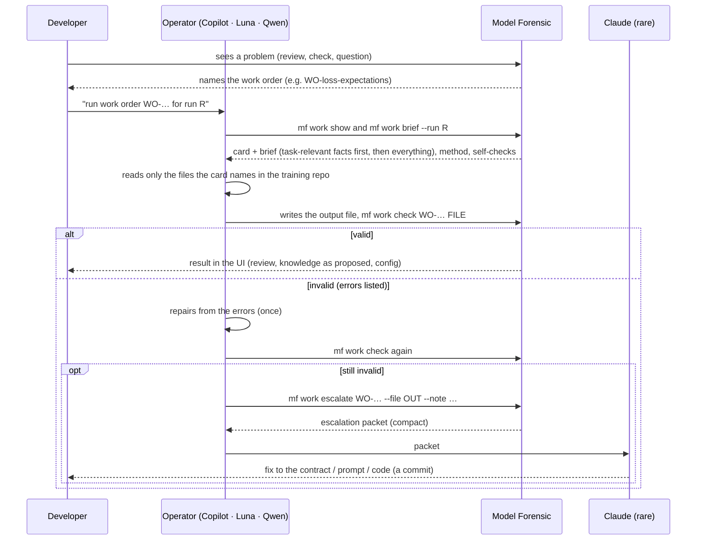

# Design review — bottlenecks, restructuring and the planner / executor model

Status: decided (see [ADR-0013](adr/0013-planner-executor-work-orders.md)). Date: 2026-11.
The resulting modular design — components, layers (enforced by a test), modules, storage, tools, extension points —
is [modular-design.md](modular-design.md); the generated inventory is [modules.md](modules.md).
Scope: the whole system as it stands after Prompt 5 and its follow-ups — backend (≈35k lines), web (≈9k lines),
instrumentation kit, the local-LLM touchpoints, and how work is split between Claude, Copilot / Luna and a local
Qwen-class model.

---

## 1. The constraint that shapes everything

| | Claude (architect) | Copilot with Luna, or local Qwen (operator) | Model Forensic (instrument) |
|---|---|---|---|
| Sees | this repository, the demo, invented data | the **real** runs, configs, training code, data | the real runs (read-only), what operators write |
| Strength | design, contracts, reasoning across the system | presence: can open any file, run any command there | deterministic, repeatable measurement |
| Weakness | never sees real data, code or configs | weaker judgement: drifts on open-ended tasks, mixes up similar names, stops at the first plausible answer, rarely checks itself (context is not the limit) | cannot read the training code |
| Cost | expensive — use rarely, for decisions | cheap — use for every recurring task | free |

So quality has to come from **structure**, not from the operator's intelligence: Claude writes the plans, contracts
and checks once; the operator executes small, fully specified **work orders** against the real environment; Model
Forensic validates every output deterministically and shows the result. When a work order fails its validation
twice, the operator writes a short **escalation packet** — the only thing that ever goes back to an expensive model.

## 2. System today

### 2.1 Context

### 2.2 Containers and layers

### 2.3 How one run is analysed

### 2.4 API map (177 routes)

| Area | Routes | Examples |
|---|---|---|
| Runs | 44 | `/runs`, `/runs/{run}/light`, `/metrics`, `/metric-catalog`, `/loss-questions`, `/internals`, `/expectations`, `/dossier`, `/harness-brief` |
| Studies | 27 | `/studies`, `/studies/{id}/book`, chapters, hypotheses |
| Settings | 12 | LLM endpoint, team policy, storage, paths |
| Prefetch / jobs / tasks | 14 | plan, start, stop, events |
| Ledger | 8 | `/ledger`, `/ledger/{id}`, `/refresh`, `/promote`, `/ledger.md` |
| Knowledge / beliefs / docs | 14 | `/knowledge`, `/beliefs`, `/docs` |
| Compare / curves / noise | 6 | `/compare`, `/compare/loss-drift` |
| Test Space, findings, drafts, misc | 52 | `/test-space`, `/findings`, `/drafts`, `/checks`, `/facets` |

### 2.5 Where the operator is told what to do (today)

| Place | Count | Answers with | Validated by |
|---|---|---|---|
| `harness/tasks/*.md` | 12 knowledge tasks + `loss_expectations` | knowledge YAML · expectations YAML | `mf knowledge validate` · `mf expectations --check` |
| `setup-agent/01–06` | 6-step protocol | config files | `mf setup check --live`, `mf projects check` |
| `setup-agent/prompts/*.md` | 10 repair prompts | config edits | per prompt |
| `defaults/dossier_prompt.md` | 1 | a free-text report | — |
| `ai/prompt_packs/*.yaml` | 14 | in-app AI answers | `ai/grounding.py` |

## 3. Bottlenecks (ranked)

| # | Bottleneck | Evidence | Effect |
|---|---|---|---|
| B1 | **Operator instructions are scattered** over four places with four conventions (inputs, output, scope, validation, stop rules all differ) | §2.5 | a small model has to learn a new format per task; nothing tells it which task fits a problem or when to stop |
| B2 | **Briefs do not guide attention** — every harness task gets the full config and every metric name in one flat list, and the prompts ask for the answer in one go | flat lists of hundreds of keys; one-shot prompts | a weaker reasoner anchors on the first plausible key, misses the relevant 5%, and does not check itself |
| B3 | **No escalation path** — when an operator fails, a human re-explains the problem to an expensive model from scratch | — | cost, and lost context |
| B4 | **Analysis outputs have no common shape** — `Answer`, drift rows, internals notes, expectation checks, `Finding` | Expert review and dossier each re-map five shapes | every new analysis needs code in three consumers |
| B5 | **Thresholds of the newer analyses are code constants** (questions, drift, internals, expectations) | `analysis/loss_questions.py`, `loss_drift.py` | cannot be calibrated on the real runs without a code change — the very thing the operator may not do |
| B6 | **API and CLI are monoliths** — 177 routes in one 2.9k-line function, 58 commands in one 1.7k-line file | §2.4 | hard to change safely, hard for an operator to find the right place, merge conflicts |
| B7 | **Private helpers shared across analyses** (`_is_loss`, `_parse`, `_noise`, `_reach`, `_direction`) | grep | hidden coupling; refactors break neighbours |
| B8 | **No calibration loop** — the deterministic checks were tuned on synthetic curves | demo-only tests | false positives on real runs erode trust |
| B9 | Derived analyses are recomputed per request (10–80 ms on the demo) | measured | fine today; becomes visible on 300+-series pipelines with several panels open |

Not bottlenecks (measured or by design): Azure fetches (cached per run, single-flight, background tasks, Light
Mode); stage handling (one view per analysis since the stage-view change); determinism and grounding.

## 4. Decisions

| # | Decision | Fixes | When |
|---|---|---|---|
| **D1** | **Work orders**: one registry (`workorders/index.yaml`) of every operator task — trigger, inputs (commands), prompt, output contract + schema + path, scope (allowed paths), validation command, task-specific self-checks, model tier, escalation rule. `mf work list / show / brief / check`. Existing prompts stay where they are; the registry is the single entry point | B1 | **now** |
| **D2** | **Guided briefs and method**: a work order declares its focus (config-key and metric-name patterns); the brief shows those first and **everything else after, complete — nothing is cut**. Every card carries the method (collect facts first, decide second; fill the template) and a self-check list (generic + task-specific) to tick before validating | B2 | **now** |
| **D3** | **Escalation packet**: after two failed validations the operator writes a fixed-format packet (work order, inputs digest, its output, the validator's errors, what it tried) — compact, because the expensive model is paid per token — for Claude / Opus / Haiku | B3 | **now** (format + `mf work escalate`) |
| D4 ✓ | **Observation contract**: one `Observation` type (id, source, status, statement, evidence keys, cause kind, next step, provenance) produced by every analysis; review, dossier, ledger and study book consume only it | B4 | done: `domain/observation.py`, producers in `application/observations.py`, `GET /runs/{run}/observations`; the study book's *Problems at a glance*, next steps and summary |
| D5 ✓ | **Analysis parameters in config**: every threshold of questions / drift / internals / expectations moves to `defaults/analysis.yaml`, overridable in `config/team.local.yaml` → `analysis_params` (as the plugins already are) | B5, B8 | done |
| D6 ✓ | **Calibration work order**: the operator runs `mf questions --json` on 10–20 real runs, marks each problem *true / false / unsure* in a fixed YAML; Model Forensic proposes threshold changes (D5) from it; a person accepts | B8 | done |
| D7 ✓ | **Split API and CLI by area** into routers / command groups (`api/routes/{runs,studies,ledger,knowledge,…}.py`, `cli/{…}.py`), no behaviour change, one area per PR | B6 | done: 11 route modules + 7 command modules, guarded by route / command snapshots |
| D8 ✓ | **Public series helpers**: `analysis/series_ops.py` (names, splits, smoothing, reach, noise, direction) replaces the private cross-imports | B7 | with D4 |
| D9 | Memoise derived analyses per (run, stage, baseline, series-cache generation) | B9 | when a real pipeline shows it |
| D10 ✓ | Layering, enforced: `test_architecture.py` (allowed dependencies, no private cross-module imports, catalogue current). Fixed now: `analysis` → `infrastructure` (`loss_family` → `domain/naming.py`), `application` → `container` (`make_llm` → `infrastructure/llm/factory.py`), `application` → `api` (web-build lookup → `shared/webdist.py`), `application` ↔ `ai` (offline LLM → `infrastructure/llm/offline.py`). Then the six remaining application modules: helpers moved to `domain/naming.py`, `domain/downloads.py`, `application/query_parser.py`, `shared/urls.py`; ports `ArtifactCache`, `Notifier`, `is_offline` | B6, B7 | **done** (no exceptions left) |

Rejected: moving every prompt file into one folder now (churn without benefit — the registry gives one entry point);
letting the operator edit `backend/src` or `web/src` for site fixes (breaks the read-only, config-only guarantee);
an in-tool agent loop driving the local LLM (the operator already has an agent — Copilot; the tool's job is contracts
and validation).

## 5. The planner / executor model in practice

### Rules every work order follows (written for a 4-bit model)

1. **One task, one output file.** No multi-goal prompts.
2. **Inputs are commands**, not descriptions: the card says exactly which `mf …` to run and which repository files to
   open (paths or globs); the brief puts what the task is about first and keeps everything else below it.
2a. **Collect first, decide second**: pass 1 lists the facts with their source (brief line or `file:line`); pass 2
   fills the output only from that list — the cheapest guard against a weaker model's first-plausible-answer habit.
2b. **Self-check before validating**: the card's checklist (generic + task-specific) is ticked explicitly.
3. **Fill a skeleton**, don't compose: every output has a template with the fields in order; enumerations instead of
   free text wherever a choice is finite.
4. **Never invent**: names, keys, numbers come from the brief or from a cited `file:line`.
5. **Validate, repair once, escalate**: the validation command is part of the card; its error text is the repair
   instruction.
6. **Scope is a path list**: anything outside it is out of bounds (the tool's core, Azure, git history).
7. **Tier**: `local` (Qwen/Luna can do it alone), `mid` (Luna/Copilot with the repo), `top` (needs Claude/Opus: new
   contracts, code changes). The registry marks each.

## 6. Roadmap

| Step | Content | Who |
|---|---|---|
| 1 (done in this change) | D1 work-order registry + `mf work`, D2 guided briefs + method + self-checks, D3 escalation packet | Claude |
| 2 (done) | D5 thresholds in `defaults/analysis.yaml` + `team.local.yaml` (`mf thresholds`, Settings); D6 `mf calibrate template / check / propose / apply` + WO-calibrate-questions | Claude defined; the operator judges alarms, a person accepts |
| 3 (done) | D4 Observation contract + D8 series helpers; D10 layering without exceptions | Claude |
| 4 (done) | D7 split API / CLI by area (route and command snapshots) | Claude |
| 5 | D9 when measured on a real pipeline | — |
