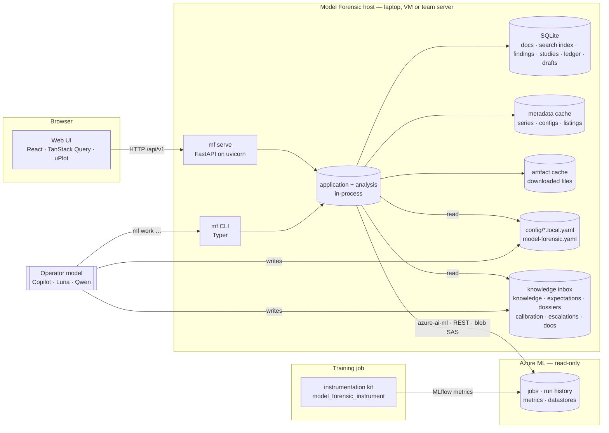
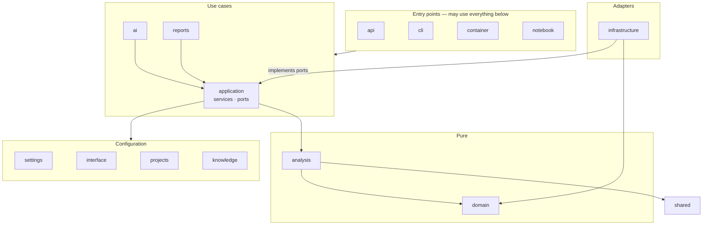

# Modular design of Model Forensic

What the tool is made of, how the parts depend on each other, which tools and libraries it uses, where data and
configuration live, and where it is meant to be extended. The **inventory** (every package and main module, sizes,
the measured import graph, external libraries) is generated from the code: [modules.md](modules.md). The **review**
behind the decisions — bottlenecks, the planner / executor model — is [design-review.md](design-review.md).
The layering below is **enforced** by `backend/tests/unit/test_architecture.py`: an import that breaks it fails CI.

## 1. Principles

1. **Read-only towards Azure.** Connectors list / get / read; nothing writes to a workspace.
2. **Deterministic first.** Every analysis is plain computation on series and configs; an LLM only explains what the
   analyses found, and its claims are grounded (`ai/grounding.py`).
3. **Configuration, not code, per site.** Workspaces, projects, facets, thresholds, team policy, knowledge are files;
   the core is the same everywhere. Site details never reach git.
4. **One stage at a time.** Pretrain, finetune and evaluation are separate views of a pipeline (`stage_view`).
5. **Planner / executor.** Claude defines contracts and work orders; an operator model in the target environment
   executes them; the tool validates (ADR-0013).

## 2. Runtime components

| Component | Technology | Started by |
|---|---|---|
| Web UI | React 18, TypeScript, Vite build, TanStack Query (server state), uPlot (charts), lucide icons | served by `mf serve` from `web/dist` |
| HTTP API | FastAPI on uvicorn, `/api/v1/*`, optional OIDC (PyJWT) or oauth2-proxy in front | `mf serve` / Docker (team server) |
| CLI | Typer (`mf …`) — every use case, also the operator models' interface | the user / an operator |
| Core | Python 3.10+, pydantic, numpy — in-process, no separate workers (threads for background tasks) | inside both |
| Storage | SQLite (documents, search, findings, studies, ledger, drafts, audit), files (metadata cache, artifacts) | created on first use |
| Azure | azure-ai-ml, azure-identity, azure-storage-blob, REST (run history), optional mlflow-skinny | `azure` extra |
| Instrumentation | dependency-free Python package in the training image (uses torch / mlflow / numpy if present) | the training job |

## 3. Layers and allowed dependencies

| Package | May import | Never |
|---|---|---|
| `domain`, `shared` | nothing of Model Forensic | — |
| `analysis` | `domain`, `shared` | I/O, adapters, the LLM, application |
| `knowledge`, `observability` | `shared` (+ `domain`) | — |
| `settings`, `interface` | each other, `knowledge`, `shared` | services |
| `application` | `analysis`, `domain`, `shared`, configuration packages; adapters only through ports (`application/ports.py`: `RunSource`, `SearchIndex`, `FindingStore`, `StudyStore`, `LLMProvider`, `ArtifactCache`, `Notifier`) — no exceptions | `api`, `cli`, `container`, `ai`, `infrastructure` |
| `infrastructure` | `application` (the ports it implements), `domain`, `shared`, `settings` | `api`, `cli` |
| `ai`, `reports` | `application`, `analysis`, `domain`, `shared` (+ `knowledge`, `infrastructure` for ai) | entry points |
| `container` | everything except `api` / `cli` — **the only place that wires** | — |
| `api`, `cli`, `notebook` | everything | each other (cli may start the api) |

No known debt (D10 closed): the pure helpers the application used from `infrastructure` moved to where they belong —
metric naming rules → `domain/naming.py`, download profiles and selection → `domain/downloads.py`, the search query
parser → `application/query_parser.py`, LLM URL helpers → `shared/urls.py` — and the rest is behind ports
(`ArtifactCache`, `Notifier`, `is_offline(llm)`; the container's `make_llm` / `make_notifier` build the adapters).
The test now forbids any `application` → `infrastructure` import.

## 4. Modules by responsibility

| Responsibility | Backend | API | CLI | UI |
|---|---|---|---|---|
| Runs, stages, series, configs, files | `application/service.py`, `stages.py`, `run_loader.py`, `tasks.py`, `prefetch.py`; `infrastructure/connectors/*` | `/runs/*`, `/prefetch/*`, `/tasks` | `mf sync`, `search`, `prefetch`, `status` | Runs, Run page tabs, Prefetch |
| Deterministic analyses | `analysis/plugins/*`, `loss_questions.py`, `loss_drift.py`, `loss_dynamics.py`, `internals.py`, `divergence.py`, `series_ops.py`, `thresholds.py` | `/runs/{run}/loss-questions`, `/loss-dynamics`, `/internals`, `/compare/loss-drift`, `/findings` | `mf questions`, `drift`, `dynamics`, `analyze`, `thresholds` | Metrics, Findings, Expert review |
| Comparison | `analysis/comparison.py`, `config_diff.py`; `application/noise.py`, `run_groups.py` | `/compare`, `/compare/curves` | `mf compare` | Compare |
| Against the codebase | `application/expectations.py`, `harness.py` | `/runs/{run}/expectations`, `/harness-brief` | `mf expectations`, `harness brief` | Expert review |
| Knowledge & beliefs | `knowledge/*`, `application/knowledge.py`, `beliefs.py` | `/knowledge`, `/beliefs`, `/docs` | `mf knowledge …` | Knowledge |
| Studies, ledger, reports, dossier | `application/study.py`, `ledger.py`, `dossier.py`; `reports/*` | `/studies/*`, `/ledger/*`, `/runs/{run}/dossier`, `/reports` | `mf study …`, `ledger …`, `dossier` | Studies, Ledger, Reports |
| Operator work | `application/workorders.py`, `question_calibration.py`, `facets.py`; `workorders/index.yaml` | `/facets` | `mf work …`, `calibrate …`, `facets` | — |
| Configuration & checks | `settings.py`, `interface/*`, `projects/*`, `application/config_checks.py`, `setup_check.py` | `/settings/*`, `/checks` | `mf checks`, `setup check`, `doctor`, `paths` | Settings, Diagnostics |
| AI (grounded) | `ai/*`, `infrastructure/llm/*` | `/investigate`, `/ai/*` | `mf ask` | AI investigation, Explain |

### Where the entry points live (D7)

| Area | API (`api/routes/`) | CLI (`cli/`) |
|---|---|---|
| system, health, tasks, downloads | `system.py`, `prefetch.py` | `server.py` (serve, status, stop, doctor, checks, setup, projects, paths) |
| runs, series, files | `runs.py`, `run_analysis.py` | `runs.py` (demo, sync, search, show, compare, report, download, inspect) |
| settings, thresholds | `settings.py` | `analysis.py` (thresholds, calibrate …) |
| analyses (questions, drift, expectations, observations, dossier) | `run_analysis.py`, `compare.py` | `analysis.py` |
| work orders, facets | `work.py` | `work.py` |
| AI | `llm.py` | `quality.py` (ai-eval, calibrate), `runs.py` (ask) |
| knowledge, docs, harness | `knowledge.py` | `knowledge.py` |
| findings, reports | `findings.py` | `quality.py` (check, gate, noise, plugins) |
| studies, ledger | `studies.py` | `studies.py` |

Shared pieces: `api/common.py` (request models, job registry, error diagnosis, build info), `api/routes/context.py`
(`RouteContext`: the state the areas share), `cli/base.py` (the Typer app, `make_container`, `ConfigOpt`).

### Stage scope: what each view reads when a stage is picked

One stage picker per page (run page and Compare page, at the right of the tabs, kept in the URL as `?stage=`).
Under the tabs, one line says what the open tab reads. Pretrain, finetune and evaluation are never mixed.

| Scope | Views | How |
|---|---|---|
| what the stage logged | Overview, Expert review, Metrics (questions, drift, dynamics, internals), Plots, Uncertainty, dossier; Compare deltas, curves, Metrics, Plots, Uncertainty | `stage_view(series, stage)` on the server (`?stage=`) |
| the stage's own run | Config, Logs, Findings, Setup (run page); Setup, Findings (Compare) | a stage is a child run: `useStageRun(run, stage)` → its run id |
| the stage first, others one click away | Precision & recall, Sequences, Dataset, Compute, Artifacts | the view opens filtered on the stage |
| the whole pipeline | Timeline, AI investigation | by design: about all stages together |

## 5. Data and configuration

| Where | What | Written by |
|---|---|---|
| `<data_dir>/forensic.sqlite` (index role) | documents: studies, ledger, drafts, findings, audit; search index | the tool |
| `<data_dir>/meta/` | cached run metadata, series, configs (size-capped) | the tool |
| `<data_dir>/artifacts/` | downloaded files (logs, configs, Lightning metrics automatically; the rest on request) | the tool |
| `model-forensic.yaml`, `config/azure.local.yaml`, `config/projects/*.local.yaml` | site: workspaces, projects, paths, workers | a person / `WO-connect-project` |
| `config/team.local.yaml` | team policy, **analysis thresholds** (`analysis_params`) | a person / `mf calibrate apply` |
| `config/facets.local.yaml` | filter facets | `WO-filter-facets` |
| `config/knowledge/` (the inbox) | knowledge YAML, `expectations/`, `dossiers/`, `calibration/`, `escalations/`, `docs/` | operators (proposed), the tool |
| `defaults/*.yaml` (in the package) | task catalogue, facets, analysis thresholds, dossier prompt | Claude (code review) |
| `workorders/`, `harness/`, `setup-agent/` | operator contracts and prompts | Claude (code review) |

## 6. Extension points

| To add | Do | Contract / test |
|---|---|---|
| An analysis | a plugin in `analysis/plugins/` or a site plugin folder (`plugin_dirs`) | `analysis/base.py` (`Requirement`, `AnalysisResult`) |
| A data source | a connector (`infrastructure/connectors/`) implementing `RunSource` | `projects/contract.py` (adapter contract) |
| A project | `config/projects/<id>.local.yaml` | `mf projects check` |
| A health question | a `_q_*` in `analysis/loss_questions.py`, thresholds in `defaults/analysis.yaml` | `test_loss_questions.py`, `test_thresholds.py` |
| An operator task | an entry in `workorders/index.yaml` + its prompt | `test_workorders.py` |
| Knowledge from code | a harness task in `harness/tasks/` (+ work order) | `harness/knowledge.schema.json` |
| An AI prompt | a prompt pack (`ai/prompt_packs/*.yaml`) | grounding |
| A UI feature | a component + an entry in `web/src/lib/features.ts` (level, cost) | e2e journeys |

## 7. Tools

| Purpose | Tool |
|---|---|
| Lint / format | ruff (`ruff check`, `ruff format`) |
| Types | mypy `--strict` (backend), `tsc -b` (web) |
| Tests | pytest + hypothesis (unit), Playwright (67 end-to-end journeys on the demo), architecture test |
| Build | hatch (Python wheel), Vite (web bundle, writes `build.json` for the stale-build banner) |
| Docs | Markdown + Mermaid; `scripts/module_map.py` generates [modules.md](modules.md) |
| Deploy | Docker / compose with oauth2-proxy (team server, `deploy/`), or `mf serve` locally |
| Operator models | Copilot (Luna), local Qwen via any OpenAI-compatible server; Claude / Opus / Haiku for escalations |

## 8. Design choices revisited

| Choice | Verdict | Change |
|---|---|---|
| Hexagonal layers with ports | **keep** — it is what makes connectors and LLMs replaceable | now enforced by a test; three violations fixed (below) |
| `analysis` independent of I/O | **keep** | `loss_family` moved from the naming adapter to `domain/naming.py` |
| Application never imports entry points | **keep** | `make_llm` moved from `container` to `infrastructure/llm/factory.py`; web-build lookup moved from `api` to `shared/webdist.py` |
| Offline LLM in `ai` | **changed** | it is an adapter: `infrastructure/llm/offline.py` (removes the `application` ↔ `ai` cycle) |
| Shared helpers between analyses | **changed** (D8) | `analysis/series_ops.py` replaces seven private cross-imports; a test forbids new ones |
| One SQLite document store | **keep** — enough for a team server; studies, ledger, drafts share it | — |
| Thresholds as code | **changed** (D5) | `defaults/analysis.yaml` + team overrides + calibration (D6) |
| Each analysis returns its own shape | **changed** (D4) | one `Observation` (`domain/observation.py`); producers in `application/observations.py`; Expert review, dossier, ledger and study book (*Problems at a glance*, next steps, summary) read only it |
| API and CLI in one file each | **changed** (D7) | `api/routes/<area>.py` (11 areas, registered in the original order by `api/app.py`), `cli/<area>.py` (7 areas on `cli/base.app`); `tests/snapshots/` + `test_interface_snapshot.py` keep every route and command and forbid shadowing |
| Application → adapter helpers | **changed** (D10) | helpers moved to `domain` / `shared` / `application`, the rest behind ports; the test allows no exception |
