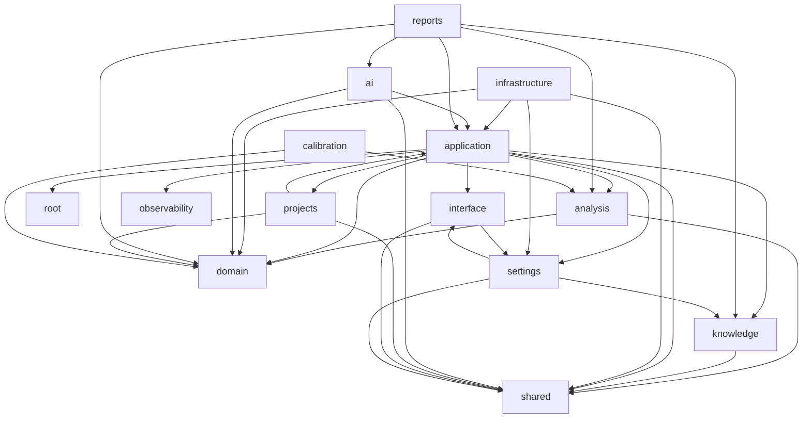

# Module catalogue (generated)

Generated by `python scripts/module_map.py` from the code — do not edit; a test fails when it is out of date. The design (layers, rules, decisions) is in [modular-design.md](modular-design.md).

## Backend packages

| Package | Purpose | Files | Lines | Depends on | Used by |
|---|---|---|---|---|---|
| `domain` | Pure types: runs, metric keys and series, findings, comparisons, configs, studies. No I/O. | 14 | 1340 | — | `ai`, `analysis`, `api`, `application`, `calibration`, `cli`, `infrastructure`, `projects`, `reports` |
| `shared` | Cross-cutting utilities: errors, paths, retry, logging, identity, downsampling, web-build location. | 11 | 503 | — | `ai`, `analysis`, `api`, `application`, `cli`, `container`, `infrastructure`, `interface`, `knowledge`, `projects`, `settings` |
| `analysis` | Deterministic computation: analysis plugins, health questions, loss drift, internals, divergence, thresholds, series helpers. Reads domain types, never I/O or an LLM. | 32 | 9173 | `domain`, `shared` | `api`, `application`, `calibration`, `cli`, `container`, `notebook`, `reports` |
| `knowledge` | Team knowledge: entries, store, inbox, documentation index, beliefs model. | 7 | 1155 | `shared` | `api`, `application`, `cli`, `container`, `reports`, `settings` |
| `application` | Use cases: the ForensicService (runs, series, configs, compare), run loading, tasks, prefetch, studies, ledger, expectations, dossier, work orders, calibration, checks. Defines the ports. | 44 | 9998 | `(root)`, `analysis`, `domain`, `interface`, `knowledge`, `observability`, `projects`, `settings`, `shared` | `ai`, `api`, `cli`, `container`, `infrastructure`, `notebook`, `projects`, `reports` |
| `infrastructure` | Adapters: Azure ML / local / demo connectors, SQLite persistence and caches, artifact store, search index, LLM providers (OpenAI-compatible, offline heuristic), notifications. | 24 | 4432 | `application`, `domain`, `settings`, `shared` | `api`, `cli`, `container` |
| `ai` | Grounded AI on top of the application: investigator, copilot, tools, prompt library, grounding. | 8 | 1571 | `application`, `domain`, `shared` | `api`, `cli`, `container`, `reports` |
| `reports` | Markdown / HTML reports and the study book. | 5 | 2304 | `ai`, `analysis`, `application`, `domain`, `knowledge` | `api`, `cli`, `container` |
| `projects` | Project profiles and the adapter contract (config/projects/*.local.yaml). | 3 | 321 | `application`, `domain`, `shared` | `api`, `application`, `cli`, `container` |
| `interface` | Site configuration readers: Azure workspaces, team policy (config/*.local.yaml). | 3 | 373 | `settings`, `shared` | `api`, `application`, `cli`, `container`, `settings` |
| `settings` | Settings model: paths, backends, LLM, storage (model-forensic.yaml + environment). | 1 | 157 | `interface`, `knowledge`, `shared` | `api`, `application`, `cli`, `container`, `infrastructure`, `interface`, `notebook` |
| `observability` | Telemetry counters and timings. | 2 | 61 | — | `api`, `application` |
| `calibration` | Calibration of the comparison thresholds against replicate runs (P2.2). | 1 | 277 | `analysis`, `domain` | `cli` |
| `container` | Wiring: builds every service and adapter from the settings (the only place that does). | 1 | 302 | `ai`, `analysis`, `application`, `infrastructure`, `interface`, `knowledge`, `projects`, `reports`, `settings`, `shared` | `api`, `cli`, `notebook` |
| `api` | FastAPI app: the HTTP interface of every use case, auth, serving the web UI. | 17 | 3452 | `(root)`, `ai`, `analysis`, `application`, `container`, `domain`, `infrastructure`, `interface`, `knowledge`, `observability`, `projects`, `reports`, `settings`, `shared` | `cli` |
| `cli` | The `mf` command line: every use case from a terminal (and for operator models). | 10 | 2000 | `(root)`, `ai`, `analysis`, `api`, `application`, `calibration`, `container`, `domain`, `infrastructure`, `interface`, `knowledge`, `projects`, `reports`, `settings`, `shared` | — |
| `notebook` | Helpers for using Model Forensic from a Jupyter notebook. | 1 | 156 | `analysis`, `application`, `container`, `settings` | `(root)` |
| `(root)` | Package metadata (`__version__`). | 1 | 14 | `notebook` | `api`, `application`, `cli` |

## Package dependencies

`container`, `api`, `cli` and `notebook` are the outer layer: they may use every package above (and nothing uses them except the entry points).

## Main modules

### `domain`

- `model_forensic/domain/naming.py` (266 lines) — Map raw metric names logged by training code to canonical :class:`MetricKey` s.
- `model_forensic/domain/downloads.py` (173 lines) — What to download from a run: the download profiles, selection of a run's files by profile, progress and the
- `model_forensic/domain/study.py` (167 lines) — A Study: the record of investigating one experiment or a small group of experiments.
- `model_forensic/domain/metrics.py` (160 lines) — Typed metric model.
- `model_forensic/domain/run.py` (125 lines) — The normalized Run: the single shape every backend connector must produce.
- `model_forensic/domain/findings.py` (120 lines) — Structured findings: the contract between computation, interpretation and recommendation.
- `model_forensic/domain/messages.py` (73 lines) — Classified parser / schema messages — what a reader could not do, how bad it is, and what to do about it.
- `model_forensic/domain/plotspec.py` (59 lines) — Plot specifications — a plot as validated data (schema v1).

### `shared`

- `model_forensic/shared/logging.py` (99 lines) — Structured JSON logging with secret redaction.
- `model_forensic/shared/paths.py` (84 lines) — Filesystem helpers: the two roots relative paths resolve against, and safe joins.
- `model_forensic/shared/yamlsafe.py` (78 lines) — YAML for untrusted run configs: safe, but tolerant of the Python tags Hydra/OmegaConf dumps contain.
- `model_forensic/shared/errors.py` (60 lines) — Error model.
- `model_forensic/shared/retry.py` (48 lines) — Bounded exponential backoff with jitter.
- `model_forensic/shared/downsample.py` (35 lines) — Shape-preserving downsampling for charts.
- `model_forensic/shared/webdist.py` (34 lines) — Where the built web UI is: shared by the API (to serve it) and the configuration checks (to report it).
- `model_forensic/shared/identity.py` (29 lines) — Who is making the request. Local mode: "local". Server mode: set per request by the auth middleware.

### `analysis`

- `model_forensic/analysis/plugins/heads.py` (893 lines) — Analyses for uncertainty heads, streaming temporal memory and loss-term interactions.
- `model_forensic/analysis/plugins/architecture.py` (875 lines) — Architecture-level analyses over metrics logged by the instrumentation kit (model_forensic_instrument).
- `model_forensic/analysis/loss_questions.py` (774 lines) — Training health questions: the questions to ask of a run's losses, each answered from its series.
- `model_forensic/analysis/study_checks.py` (531 lines) — Deterministic study checks (the pitfall catalog P1–P8) and the loss ledger.
- `model_forensic/analysis/plugins/pipeline.py` (497 lines) — Pipeline stage deltas: what changed between evaluation stages of one pipeline (e.g. pretrain → finetune).
- `model_forensic/analysis/loss_dynamics.py` (494 lines) — Loss dynamics: what the learning-rate schedule did vs what the model learned (A1), and how fast each loss term
- `model_forensic/analysis/baseline_study.py` (443 lines) — The baseline study: how each loss family progressed, which losses the uncertainty weighting (σ) trusts or mutes,
- `model_forensic/analysis/plugins/study.py` (430 lines) — Study checks (pitfall catalog P1–P8) and the loss ledger as analyses.

### `knowledge`

- `model_forensic/knowledge/beliefs.py` (354 lines) — Checking knowledge from experience (beliefs) against runs — deterministic, probabilistic, explained.
- `model_forensic/knowledge/docindex.py` (264 lines) — Full-text index of the documentation in all knowledge sources (SQLite FTS5, one row per section).
- `model_forensic/knowledge/store.py` (174 lines) — Knowledge files: every ``*.yaml`` under the knowledge folder (git-ignored — site knowledge stays out of git).
- `model_forensic/knowledge/sources.py` (162 lines) — Knowledge sources: where knowledge and documentation live, across codebases.
- `model_forensic/knowledge/engine.py` (101 lines) — Which entries apply to a run (or one stage of it), and what they change.
- `model_forensic/knowledge/model.py` (87 lines) — Knowledge entries (schema mirrored in ``harness/knowledge.schema.json``).

### `application`

- `model_forensic/application/service.py` (1033 lines) — Application facade: orchestrates retrieval (ports) → computation (analysis) → persistence.
- `model_forensic/application/prefetch.py` (675 lines) — Artifact prefetch tasks: plan first, then download — observable, stoppable, resumable, integrity-safe.
- `model_forensic/application/study.py` (603 lines) — Study use cases: build up the record of one investigation, op by op.
- `model_forensic/application/expectations.py` (403 lines) — Expected vs actual: what the training code says the losses should do, checked against what they did.
- `model_forensic/application/setup_check.py` (348 lines) — Target-setup compatibility report: what Model Forensic needs, what this machine and project provide.
- `model_forensic/application/ledger.py` (333 lines) — Experiment ledger: hypothesis → change → outcome → decision, one entry per experiment.
- `model_forensic/application/dossier.py` (332 lines) — The analysis dossier: everything Model Forensic found about a run, as one document for an interpreting LLM.
- `model_forensic/application/test_space.py` (314 lines) — Test Space — measure task cost on sample runs, test hypotheses, propose reviewed changes to the master config.

### `infrastructure`

- `model_forensic/infrastructure/demo/synthetic.py` (1487 lines) — Deterministic synthetic runs that tell realistic forensic stories.
- `model_forensic/infrastructure/connectors/azureml/connector.py` (423 lines) — Azure ML connector.
- `model_forensic/infrastructure/artifacts/store.py` (340 lines) — Artifact download engine.
- `model_forensic/infrastructure/search/sqlite_index.py` (323 lines) — SQLite search index: structured columns + FTS5 trigram index for fuzzy text.
- `model_forensic/infrastructure/connectors/azureml/diagnose.py` (318 lines) — Turn Azure connection failures into a cause and concrete fixes.
- `model_forensic/infrastructure/connectors/azureml/runhistory.py` (279 lines) — Azure ML run-history data plane: pipeline stages, metric histories and run files.
- `model_forensic/infrastructure/persistence/sqlite_store.py` (236 lines) — Document persistence for findings, studies, conversations and reports (SQLite, JSON docs).
- `model_forensic/infrastructure/connectors/local/connector.py` (222 lines) — Local filesystem connector.

### `ai`

- `model_forensic/ai/context.py` (337 lines) — Investigation context builder.
- `model_forensic/ai/investigator.py` (317 lines) — AI investigation orchestrator.
- `model_forensic/ai/prompts.py` (237 lines) — Parameterized, versioned prompt library.
- `model_forensic/ai/tools.py` (213 lines) — Bounded, permission-controlled tools the investigator may call.
- `model_forensic/ai/copilot.py` (202 lines) — AI copilot features that stay grounded.
- `model_forensic/ai/grounding.py` (149 lines) — Grounding checks for AI output (anti-hallucination).
- `model_forensic/ai/eval_harness.py` (115 lines) — AI evaluation harness: fixed questions on the demo runs, scored on grounding — for any configured model.

### `reports`

- `model_forensic/reports/study_book.py` (1152 lines) — Study book: run ids in, a multi-chapter forensic book out — deterministic, every number from an artefact.
- `model_forensic/reports/book_parts.py` (704 lines) — Study book parts: Part 1 studies the baseline on its own, Part 2 has one chapter per run compared with the
- `model_forensic/reports/markdown.py` (269 lines) — Forensic report generation (Markdown; HTML for print-to-PDF).
- `model_forensic/reports/svgplot.py` (179 lines) — Tiny dependency-free SVG charts for self-contained reports (theme-aware through CSS variables).

### `projects`

- `model_forensic/projects/profile.py` (175 lines) — Project profiles: how one target project maps onto Model Forensic's fixed interfaces — configuration, not code.
- `model_forensic/projects/contract.py` (141 lines) — The fixed adapter contract every run source (Azure ML, a local layout, a project's own adapter) must satisfy.

### `interface`

- `model_forensic/interface/azure.py` (281 lines) — Azure ML interface: which subscription / resource group / workspaces to read, and how to authenticate.
- `model_forensic/interface/team.py` (87 lines) — Team policy: de-prioritised classes, expected metric families, metric → code references, analysis defaults.

### `settings`

- `model_forensic/settings.py` (157 lines) — Configuration (YAML + environment). Secrets are referenced by env var name, never stored.

### `observability`

- `model_forensic/observability/telemetry.py` (61 lines) — In-process telemetry: counters and latency histograms, exported on /api/v1/diagnostics.

### `calibration`

- `model_forensic/calibration.py` (277 lines) — Labelled benchmark for the detectors: hits, false alarms and misses per check, and threshold sweeps.

### `container`

- `model_forensic/container.py` (302 lines) — Composition root: the only place that wires adapters to ports.

### `api`

- `model_forensic/api/routes/runs.py` (441 lines) — HTTP routes: /compare, /experiments, /metric-keys, /projects, /run-info, /runs, /tasks.
- `model_forensic/api/routes/findings.py` (419 lines) — HTTP routes: /analyses, /analyze, /feedback, /findings, /gate, /investigate, /metrics, /noise, /prompts, /reports, /runs, /studies, /study-templates.
- `model_forensic/api/routes/run_analysis.py` (305 lines) — HTTP routes: /runs.
- `model_forensic/api/routes/settings.py` (265 lines) — HTTP routes: /backends, /check, /facets, /glossary, /me, /scheduler, /settings.
- `model_forensic/api/common.py` (264 lines) — Shared pieces of the HTTP API: request models, the job registry, error diagnosis, build info.
- `model_forensic/api/routes/studies.py` (245 lines) — HTTP routes: /diagnostics, /studies.
- `model_forensic/api/routes/compare.py` (237 lines) — HTTP routes: /compare, /studies.
- `model_forensic/api/app.py` (220 lines) — HTTP API (FastAPI): create_app wires the shared state and registers the routes of every area

### `cli`

- `model_forensic/cli/server.py` (469 lines) — ``mf`` commands — Serving and operations: serve, status, stop, backup, init, paths, checks, doctor, setup, projects.
- `model_forensic/cli/runs.py` (436 lines) — ``mf`` commands — Runs: demo data, sync, search, show, stages, compare, analyze, report, download, inspect, cache.
- `model_forensic/cli/analysis.py` (364 lines) — ``mf`` commands — Loss and training analysis: thresholds, calibrate …, dossier, expectations, drift, questions, facets.
- `model_forensic/cli/studies.py` (210 lines) — ``mf`` commands — Studies and the experiment ledger: mf study …, mf ledger ….
- `model_forensic/cli/knowledge.py` (186 lines) — ``mf`` commands — Knowledge, documentation and harness briefs: mf knowledge …, mf docs …, mf harness ….
- `model_forensic/cli/quality.py` (172 lines) — ``mf`` commands — Run checks and AI quality: calibrate (AI), ai-eval, check, gate, noise, plugins.
- `model_forensic/cli/work.py` (106 lines) — ``mf`` commands — Work orders for operator models: mf work ….
- `model_forensic/cli/main.py` (30 lines) — ``mf`` command-line interface: the entry point.

### `notebook`

- `model_forensic/notebook.py` (156 lines) — Notebook bridge: Model Forensic's runs, series, findings and evaluation tables as pandas DataFrames.

## External dependencies

| Package | Where | Used for |
|---|---|---|
| `pydantic` | backend | typed models and validation (domain, settings, contracts) |
| `numpy` | backend | numerics of every analysis |
| `pyyaml` | backend | configuration, knowledge, expectations, work orders |
| `httpx` | backend | HTTP client (LLM endpoints, Azure REST) |
| `fastapi` | backend | HTTP API |
| `uvicorn` | backend | ASGI server for `mf serve` |
| `typer` | backend | the `mf` command line |
| `azure-ai-ml` | backend | Azure ML jobs and workspaces (read-only) |
| `azure-identity` | backend | Azure credentials |
| `azure-storage-blob` | backend | datastore files (read-only, SAS) |
| `pyarrow` | backend | per-sequence evaluation parquets |
| `pyarrow` | backend | per-sequence evaluation parquets |
| `pandas` | backend | notebook helpers |
| `pyarrow` | backend | per-sequence evaluation parquets |
| `PyJWT[crypto]` | backend | OIDC token validation (team server) |
| `mlflow-skinny` | backend | MLflow metric names / history (azure-mlflow extra) |
| `azureml-mlflow` | backend | Azure ML MLflow tracking URI (azure-mlflow extra) |
| `pytest` | backend | tests |
| `hypothesis` | backend | property tests |
| `ruff` | backend | lint + format |
| `mypy` | backend | strict typing |
| `types-PyYAML` | backend | typing stubs |
| `pyarrow` | backend | per-sequence evaluation parquets |
| `pandas` | backend | notebook helpers |
| `pandas-stubs` | backend | typing stubs |
| `@tanstack/react-query` 5.59.0 | web | server state / caching |
| `lucide-react` 0.441.0 | web | icons |
| `react` 18.3.1 | web | UI |
| `react-dom` 18.3.1 | web | UI |
| `react-router-dom` 6.26.2 | web | routing |
| `uplot` 1.6.31 | web | fast time-series charts |
| `@playwright/test` ^1.63.0 | web (dev) | end-to-end journeys |
| `@types/react` 18.3.11 | web (dev) | typing |
| `@types/react-dom` 18.3.0 | web (dev) | typing |
| `@vitejs/plugin-react` 4.3.2 | web (dev) | React for Vite |
| `typescript` 5.6.2 | web (dev) | types |
| `vite` 5.4.8 | web (dev) | build / dev server |
| (none required) | instrument | torch / mlflow / numpy used when present in the training image |

## Web UI

81 components / pages under `web/src/`; main areas:

- `web/src/pages/` (18): Ai, Check, Compare, Diagnostics, Home, Knowledge, Ledger, Library, Prefetch, Progression, Reports, RunDetail, Runs, Settings, Studies, Study, StudyWizard, TestSpace
- `web/src/pages/run/` (17): Artifacts, Config, ExpertReview, Findings, Logs, LossDrift, LossQuestions, Metrics, ModelInternals, Overview, Plots, PrecisionRecall, RunInfo, Sequences, SetupClues, Timeline, Uncertainty
- `web/src/pages/compare/` (3): Filters, RunsOverview, SetupCompare
- `web/src/components/` (36): AppState, AzureWorkspaces, Chart, ChartInsight, CommandPalette, CompareCurves, ConnectionTest, DossierButton, FeatureSettings, FindingCard, Investigation, JobTray, Layout, LlmBadge, MarkdownView, MeSettings, MetricTile, ParseMessages, PendingDownload, PlotView, ProjectSelector, PromptPicker, RowActions, RunBrowser, RunLoading, RunPicker, StageSelect, StorageSettings, StoryStrip, SubjectPicker, TaskIndicator, ThresholdSettings, Tour, ValuePanel, WorkspaceSelector, ui
- `web/src/lib/` (7): autoTitle, drafts, features, format, hooks, prompts, tableSort

## Instrumentation kit (`instrument/`, runs in the training job)

- `ablation.py` — Evaluation-time modality / module ablations — no retraining.
- `attention.py` — Decoder internals: where cross-attention looks, per layer and per modality, and how old the queries are.
- `evaluation.py` — Evaluation breakdowns: per-slice metrics (range, class, weather, ...) and nuScenes summaries.
- `forensic.py` — One object to wire the kit into a training loop.
- `losses.py` — Normalize framework loss dicts into per-term and per-decoder-layer metrics.
- `matching.py` — Matching instability of a set-prediction (DETR-style) head: does the Hungarian matching keep assigning the same
- `naming.py` — Metric naming shared with the Model Forensic backend.
- `probes.py` — Loss-term gradient probe: which loss terms actually steer a shared module, and do they conflict?
- `sinks.py` — Where metrics go. All sinks take canonical names; MLflow-bound sinks encode them.
- `stability.py` — Early warnings of a training instability, before the loss shows it (Wortsman et al., 2024, *Small-scale proxies
- `temporal.py` — Temporal / streaming-query diagnostics (StreamPETR-style memory queues).
- `torch_monitors.py` — PyTorch monitors: per-module gradient / update health and feature statistics.
- `uncertainty.py` — Uncertainty diagnostics for regression heads that predict a scale (aleatoric uncertainty).
